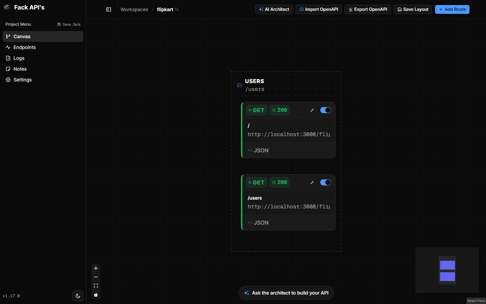
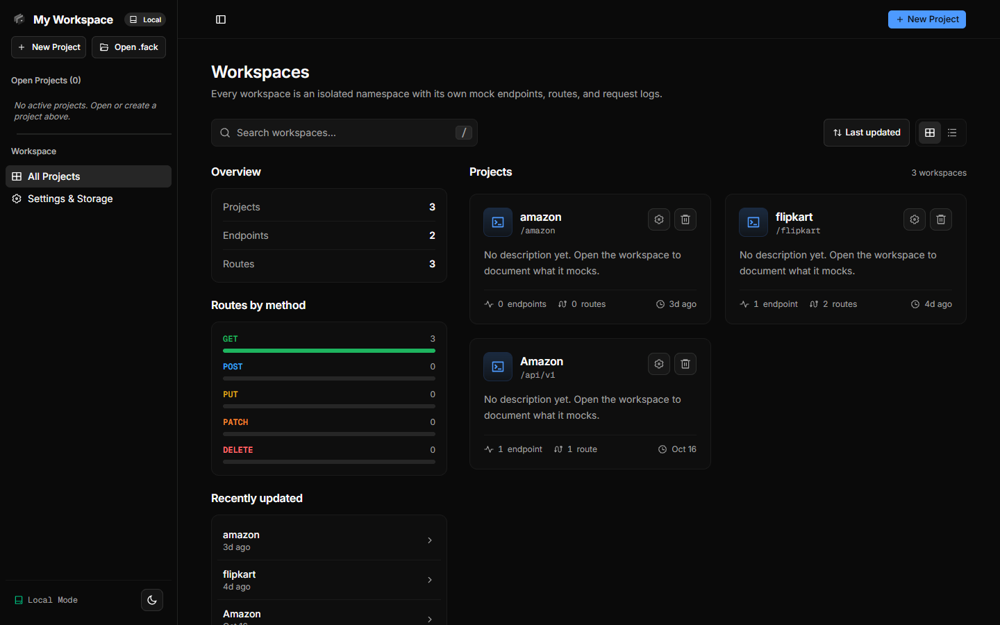
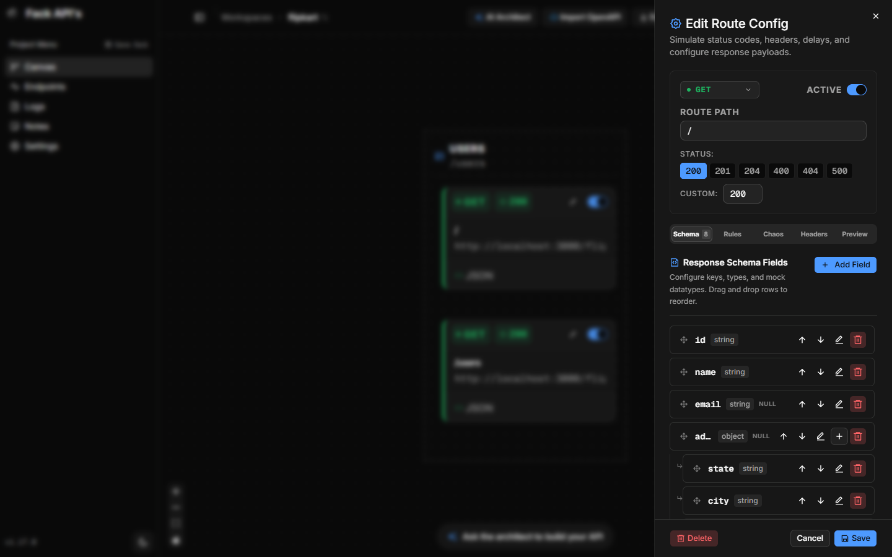
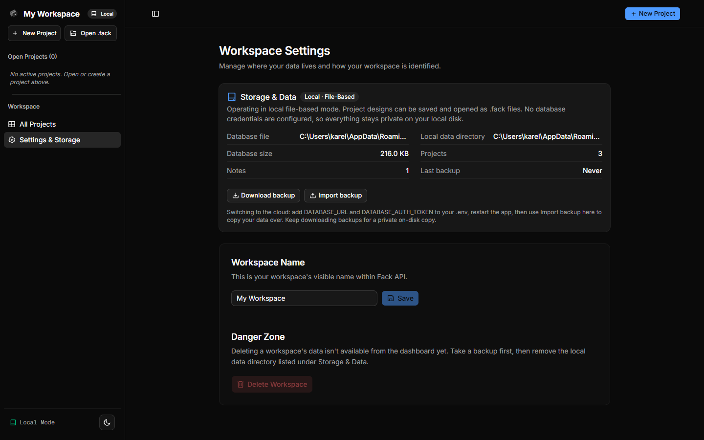
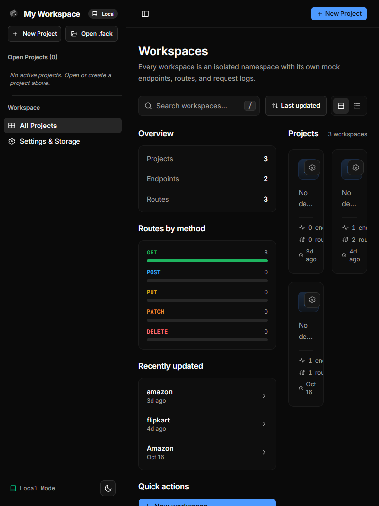
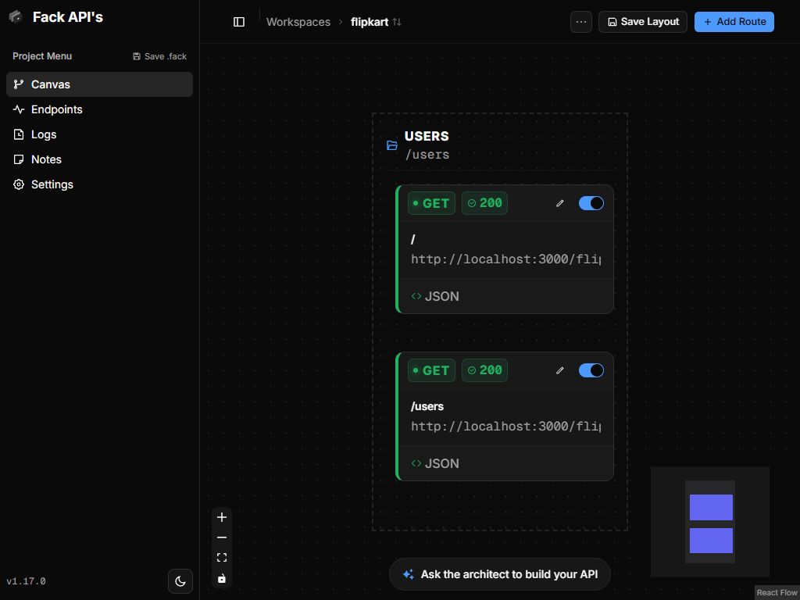
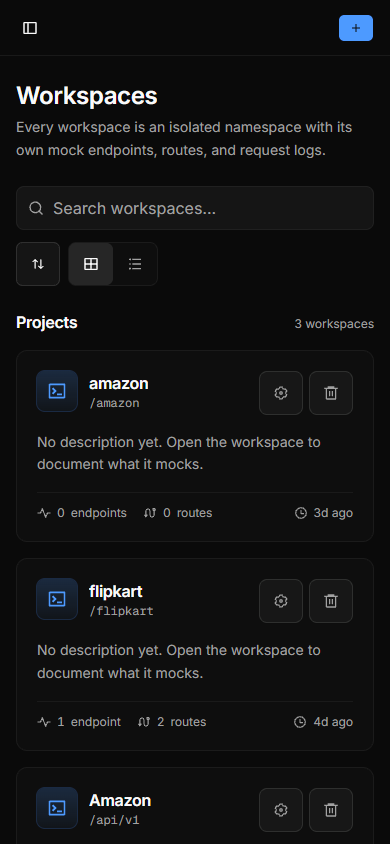
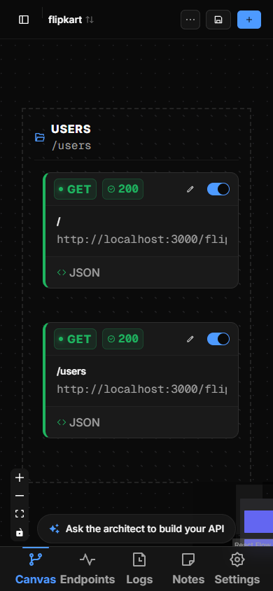
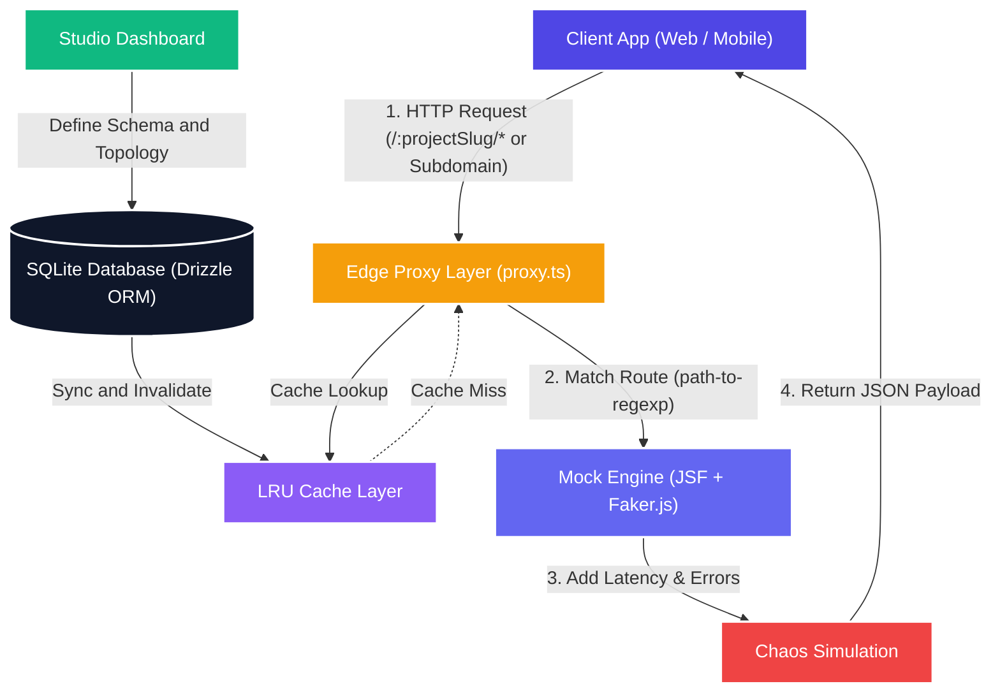

<p align="center">
  
</p>

<h1 align="center">Fack API</h1>

<p align="center">
  A node-based mock API platform and visual schema designer for decoupled frontend and backend development.
</p>

<p align="center">
  <a href="https://nextjs.org"></a>
  <a href="https://react.dev"></a>
  <a href="https://www.typescriptlang.org"></a>
  <a href="https://tailwindcss.com"></a>
  <a href="https://orm.drizzle.team"></a>
  <a href="https://sqlite.org"></a>
  <a href="https://docker.com"></a>
  <a href="./LICENSE"></a>
</p>

---

Fack API is a self-hostable mock backend platform. It gives frontend and mobile teams realistic HTTP endpoints before the actual backend exists. You can design endpoints on a visual node canvas, configure nested JSON schemas, map fields to Faker.js data generators, simulate latency and network errors, and export TypeScript contracts. Everything runs locally on SQLite by default, with optional cloud synchronization through Turso.

---

## Interface Across Devices

### Desktop

<table>
  <tr>
    <td width="50%" align="center">
      <strong>Node-based canvas designer</strong><br />
      
    </td>
    <td width="50%" align="center">
      <strong>Workspaces dashboard</strong><br />
      
    </td>
  </tr>
  <tr>
    <td width="50%" align="center">
      <strong>Route configuration & schema builder</strong><br />
      
    </td>
    <td width="50%" align="center">
      <strong>Workspace settings & storage tiers</strong><br />
      
    </td>
  </tr>
</table>

### Tablet and Mobile

<table>
  <tr>
    <td width="50%" align="center">
      <strong>Tablet: Workspaces dashboard (768px)</strong><br />
      
    </td>
    <td width="50%" align="center">
      <strong>Tablet: Canvas topology (1024px)</strong><br />
      
    </td>
  </tr>
  <tr>
    <td width="50%" align="center">
      <strong>Mobile: Workspace browser (390px)</strong><br />
      
    </td>
    <td width="50%" align="center">
      <strong>Mobile: Canvas and bottom navigation (390px)</strong><br />
      
    </td>
  </tr>
</table>

---

## Core Capabilities

- Node canvas built with React Flow (@xyflow/react) to lay out endpoints, methods, and status codes graphically.
- Nested schema editor supporting objects, arrays, primitives, and nullables without hand-writing JSON Schema.
- Mock data synthesis via Faker.js, covering names, addresses, dates, internet identifiers, and UUIDs.
- Chaos testing controls to inject randomized delays, min/max latency, and error rates per route.
- Direct path routing (`http://localhost:3000/:projectSlug/...`) and subdomain routing (`http://:projectSlug.localhost:3000/...`).
- In-memory LRU cache layer with configurable TTL and manual cache invalidation.
- Client contract export to download TypeScript definitions (`.d.ts`) directly from visual schemas.
- Dual storage support: private SQLite file on disk with zero configuration, or remote cloud storage with Turso.

---

## Architecture



---

## Technology Stack

| Layer                | Technology                      | Details                                                    |
| :------------------- | :------------------------------ | :--------------------------------------------------------- |
| Framework            | Next.js 16 (Turbopack)          | App Router, server actions, and edge proxy handler         |
| Frontend             | React 19                        | UI component layer                                         |
| Visual Canvas        | React Flow (@xyflow/react v12)  | Interactive node graph and routing canvas                  |
| Component Primitives | Base UI and Radix UI            | Accessible headless primitives styled with Tailwind CSS v4 |
| State Management     | Zustand v5 and Immer            | Canvas state and route store                               |
| Database and ORM     | Drizzle ORM (v0.45) with SQLite | Local file via @libsql/client or remote Turso database     |
| Data Generator       | json-schema-faker and Faker.js  | Generates typed synthetic response bodies                  |
| Path Matching        | path-to-regexp                  | Express-compatible parameter extraction                    |
| Type Compiler        | json-schema-to-typescript       | Generates TypeScript interfaces from visual schemas        |
| Test Runner          | Vitest v4                       | Unit and integration test suite                            |

---

## Quick Start

### Prerequisites

- Node.js 20.19 or later (Node.js 26 recommended)
- pnpm 10 or later

### Setup

1. Clone the repository:

   ```bash
   git clone https://github.com/Karelaking/fack-api.git
   cd fack-api
   ```

2. Install dependencies:

   ```bash
   pnpm install
   ```

3. Initialize database tables:

   ```bash
   pnpm drizzle-kit push
   ```

4. Start the development server:

   ```bash
   pnpm dev
   ```

5. Visit [http://localhost:3000](http://localhost:3000) for the overview or [http://localhost:3000/dashboard](http://localhost:3000/dashboard) to view your workspaces.

---

## Storage Modes

### Local Mode (Zero Configuration)

When `DATABASE_URL` is omitted or when `STORAGE_MODE=local` is set, Fack runs entirely on your local machine without authentication or remote services.

Project data, routes, and canvas layouts are saved to an SQLite file on disk:

- Windows: `%APPDATA%\fack-api\fack.db`
- macOS: `~/Library/Application Support/fack-api/fack.db`
- Linux: `~/.local/share/fack-api/fack.db`

You can customize the storage directory by setting `FACK_DATA_DIR` in your environment.

### Cloud Mode (Turso)

To share projects across machines or team members, connect a remote Turso database in `.env`:

```bash
DATABASE_URL="libsql://your-db.turso.io"
DATABASE_AUTH_TOKEN="your-token"
```

You can migrate data between local disk and Turso at any time using the migration script:

```bash
# Push local data to Turso
pnpm db:copy --from local --to libsql://your-db.turso.io

# Pull remote data down to a local file
pnpm db:copy --from libsql://your-db.turso.io --to local
```

Create backups to JSON or SQLite:

```bash
pnpm db:backup            # Copies local SQLite file to backups/
pnpm db:backup -- --remote # Exports remote Turso database to JSON
```

---

## Docker Deployment

### Docker Compose

Run Fack API alongside an optional PostgreSQL database for request logging:

```bash
docker compose up -d
```

- Studio UI is accessible at `http://localhost:3000` (or port 80 when using Nginx reverse proxy).
- SQLite data files persist inside the `fack-data` Docker volume.

### Docker Image

Pull and run the pre-built image directly:

```bash
docker pull mkkatiyar277/fake-api:latest
docker run -d -p 3000:3000 -v fack-data:/app/data mkkatiyar277/fake-api:latest
```

---

## API Usage Example

Create a workspace with slug `payment-service` and add a route `GET /v1/customers/:customerId`:

### Direct Path Request

```bash
curl -X GET http://localhost:3000/payment-service/v1/customers/cust_9923
```

### Subdomain Request

```bash
curl -X GET http://payment-service.localhost:3000/v1/customers/cust_9923
```

### Response

```json
{
  "id": "cust_9923",
  "name": "Jane Smith",
  "email": "jane.smith@example.com",
  "profile": {
    "avatar": "https://avatars.io/jane_smith",
    "jobTitle": "Lead System Architect"
  }
}
```

### Query Filtering and Pagination

```bash
curl -X GET "http://localhost:3000/payment-service/v1/customers?count=5"
```

---

## Tests

Run the test suite with Vitest:

```bash
pnpm test
```

Test coverage includes:

- `storage-mode.test.ts`: Local and cloud mode detection, credential masking, fallbacks
- `config-store.test.ts`: Atomic workspace configuration persistence on disk
- `notes.test.ts`: Notes CRUD, validator bounds, and pinning
- `backup.test.ts`: JSON/SQLite export and restore round trips
- `db-copy.test.ts`: Table migration ordering and upsert safety

Clean up leftover test databases:

```bash
pnpm db:clean
```

---

## License

This project is licensed under the MIT License. See [LICENSE](./LICENSE) for details.
